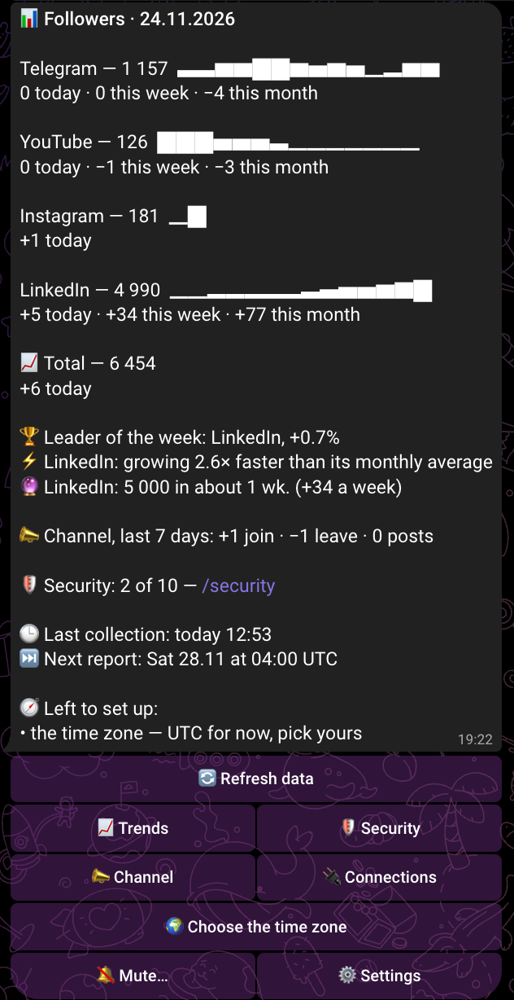
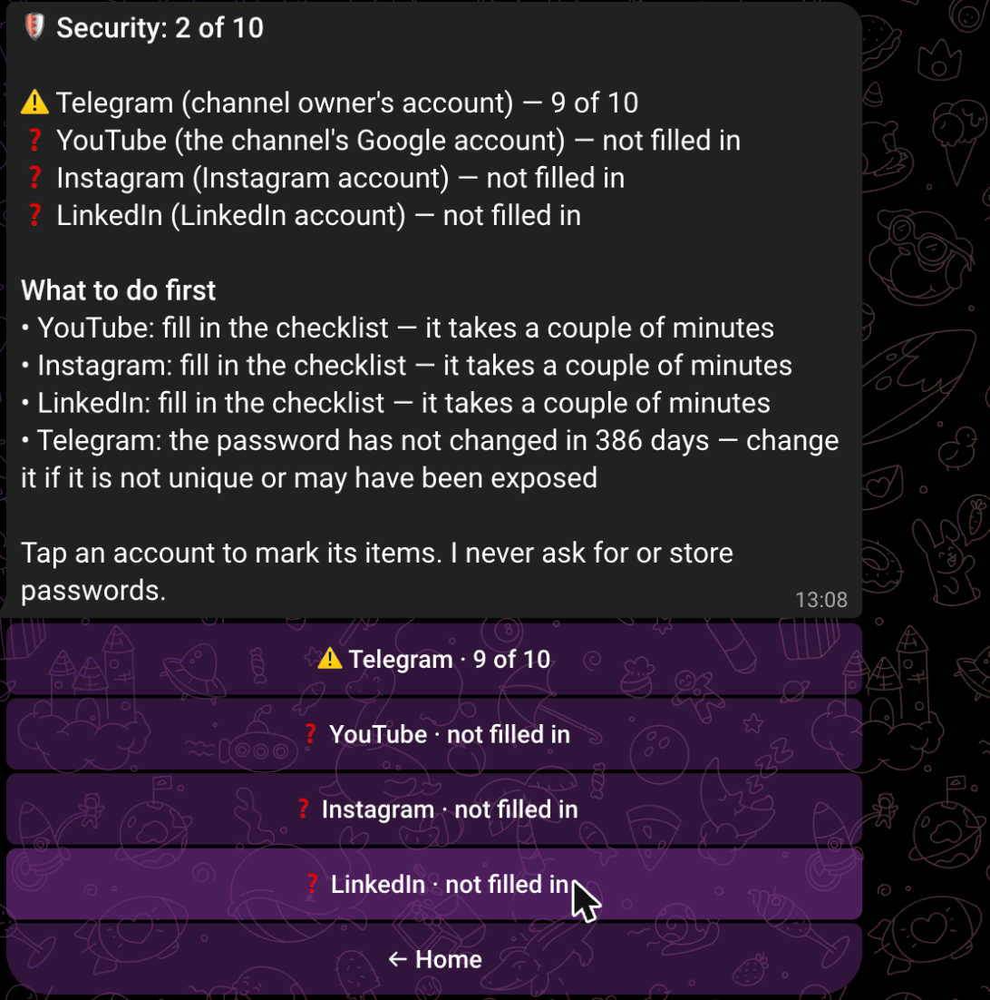
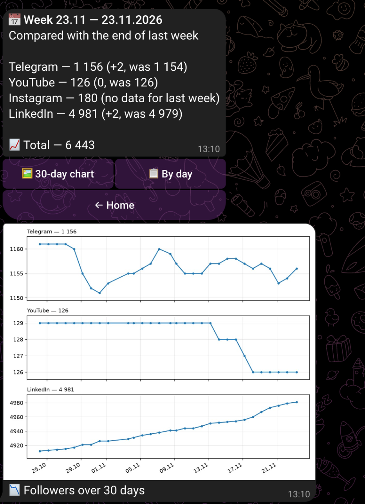

# Social Tracker Bot

> A Telegram bot that watches your social accounts: followers on Telegram, YouTube, Instagram and LinkedIn with weekly trends, and the account's security — profile changes a hijacker makes, new sign-ins and password changes from your security emails, and a 2FA/password checklist. It stays quiet while things are fine and speaks up the moment something breaks.

🇷🇺 [По-русски](README.ru.md) · [](https://railway.com/deploy/cL4hpn?referralCode=7hTMqE)

The bot talks to you in English or Russian (`BOT_LANG`); the setup is the same in both.

<p align="center">
  
  
  
</p>

## What you get

The bot is modular: connect only the platforms you have, and switch monitors on or off in `/modules`.

**Followers**

- **Daily collection, weekly report**: deltas for the day / week / month, a 14-day sparkline, a 30-day PNG chart, the week's leader by growth, a monthly digest on the 1st. Every platform is optional.
- **Signals, not noise**: milestones (1k, 5k, 10k…) on the day they're crossed, a forecast to the next one, growth speeding up or slowing down, a bot-influx detector (a jump ×5 above the usual daily gain).
- **Problems arrive at once**: a revoked Instagram token or an expired LinkedIn cookie, collection failing 2+ days in a row, a drop in followers (20 or more and at least 1%), data that has gone stale.
- **Self-recovering**: failed platforms are retried hourly (up to 3 times), a run missed while the bot was down is caught up on start, a dead man's switch (`HEALTHCHECK_URL`) tells you when the bot itself dies. Point it at a [TofsDevOps](https://github.com/morgunovtech/Tofs_DevOps_bot) heartbeat address and the ping also carries a line per network («✅ Telegram · 12 340, +18 today», «🔴 LinkedIn · profile unreadable») to TofsDevOps's main screen, next to your sites; refreshed after every profile check.
- **Your data stays yours**: SQLite on your volume, a weekly backup sent to your chat (without the LinkedIn cookie and the Instagram token), and `/restore` to merge a backup back without overwriting anything collected since.
- **Quiet mode**: a one-liner instead of the full report when nothing changed.
- **Rings only when it matters**: 🚨 and 🔴 — a likely hijack, a new sign-in, a changed password, a vanished profile — ring at once, even at night; everything else arrives silently, and during quiet hours or a `/mute` it waits and comes as one digest. See [When it writes](#when-it-writes).

**Security**

- **Profile integrity**, every 30 minutes: a hijacked channel is renamed, gets a scam link in its description, a new admin or loses its videos long before the follower count moves. The bot alerts on a changed title or name, @username, description or bio, avatar, a new or removed Telegram admin, a changed owner, a mass drop in YouTube videos or Instagram posts, and a profile that stops being readable. A link that appears in a description is marked 🚨: that is the classic hijack payload.
- **Security emails** (optional, needs the [mail-worker](mail-worker/README.md)): forward your accounts' security notifications to a Cloudflare Email Worker, and the bot alerts within 5 minutes on a new sign-in, a password, email or 2FA change, a password reset request or a login code you didn't ask for, with recovery links. Links quoted from a mail or a changed description are defanged (`hxxps://evil[.]example`), so nothing in an alert is a clickable scam link. Gmail's forwarding confirmation code is relayed to you.
- **Hygiene checklist** (`/security`): per account — 2FA and its kind, backup codes, recovery contacts, a unique password, the last password change; for Telegram, its own list — cloud password, its recovery email, only your own sessions, a unique password. A score out of 10 in every report, and a reminder at most once a month with what to fix. No network exposes this to third-party apps, so these are your own marks: **the bot never asks for a password.**

## Privacy

What leaves your server and what does not, as the code does it:

| Where | What and why |
|---|---|
| Telegram Bot API | The bot's messages to you, and the public data of your channel (follower count, title, description, admins when the bot is a channel admin). |
| YouTube Data API (`googleapis.com`) | Your channel's statistics with your own key, once a day. Only with `YOUTUBE_API_KEY`. |
| Instagram API (`graph.facebook.com`) | Your account's follower count and profile with your own token, once a day. Only with a token. |
| LinkedIn (`linkedin.com`) | Your profile page, opened with your `li_at` cookie once a day. Only with the cookie; without it you type the number in. |
| Watchdog (`HEALTHCHECK_URL`) | An empty ping after the daily run — healthchecks.io or a TofsDevOps address; TofsDevOps also gets one status line per network (count, delta). Only when set. |
| Your own site (`SITE_INGEST_URL`) | The final follower counts, POSTed with a Bearer token. Only when set. |
| OSV (`api.osv.dev`) | On Sundays, the names and versions of the bot's packages, to report known vulnerabilities. `UPDATE_WATCH=0` turns it off. |
| Your mail-worker | The bot fetches the security emails you forwarded yourself; the worker accepts only the senders in `ALLOWED_SENDERS`. |

Everything else stays with you: follower history, profile baselines, checklist answers and security events live in SQLite on your volume. The Instagram token and the LinkedIn cookie are stored there too; the message carrying either is deleted from the chat at once, and the Sunday backup is made without them. Only the owner — the first `/start`, or `ADMIN_CHAT_ID` when set — can use the bot. Logs carry no Bot API URL with the token (the httpx logger stays at WARNING). Links quoted from mails and profile descriptions are defanged in alerts (`hxxps://evil[.]example`) and previews are off. Details: [SECURITY.md](SECURITY.md).

## Setup

0. **Language.** `BOT_LANG=en` or `ru` (the default): every screen, report, alert and the `/` menu. The examples below show the Russian bot.
1. **Telegram (required).** Create a bot with [@BotFather](https://t.me/BotFather) → `BOT_TOKEN`, start it and send it `/start` right away: **the first person to do so becomes its owner**, and the bot answers nobody else. `ADMIN_CHAT_ID` (your user id, from [@userinfobot](https://t.me/userinfobot)) is optional: set it to pin the owner or to take the bot over; it wins over the stored one. To track a channel, make the bot an **admin** of it → `TELEGRAM_CHANNEL_ID`.
2. **YouTube (optional).** In [Google Cloud Console](https://console.cloud.google.com/) enable YouTube Data API v3 and create an API key → `YOUTUBE_API_KEY`; your channel id (`UC…`) → `YOUTUBE_CHANNEL_ID`.
3. **Instagram (optional).** The account must be professional (Creator or Business: Settings → Account type in the app, free). On [developers.facebook.com](https://developers.facebook.com/) create an app with the **Instagram API** use case (Meta also asks for a business portfolio: free, no verification needed for your own account), open «API setup with Unified login», create the configuration from the template, add your account as an **Instagram Tester**, accept the invitation in Instagram (Settings → Website permissions → Tester invitations) and press **Generate token**. Your @username → `INSTAGRAM_USERNAME`, then send the bot `/igtoken <token>` — it checks that the token was granted for that account, deletes your message and keeps the token (or set `INSTAGRAM_ACCESS_TOKEN` in `.env`). The token does not expire; if Meta revokes it, the bot says so once and in every report until a new one arrives. This is the official Instagram API: the bot reads only its own account's public data (followers, name, bio, post count) and watches those for a hijack.
4. **LinkedIn (optional).** Your profile URL → `LINKEDIN_PROFILE_URL`. Then either send the bot `/setcookie <li_at>` with the `li_at` cookie of a logged-in browser (DevTools → Application → Cookies → linkedin.com) — the bot checks it, deletes your message and watches the cookie's age — or enter the number by hand with the «✏️ Enter LinkedIn count» button on the home screen.

5. **Security emails (optional).** Deploy the [mail-worker](mail-worker/README.md) → `SECURITY_MAIL_URL`, `SECURITY_MAIL_TOKEN`, and set up forwarding in your mailbox.

> ⚠️ **About LinkedIn.** There is no official API for a personal profile's follower count, so the bot opens your profile page with your cookie, once a day. LinkedIn's User Agreement prohibits automated access: use it at your own risk, LinkedIn may restrict the account. Leave the cookie out and type the number in by hand if you'd rather not take that risk.

### Docker Compose

```bash
cp .env.example .env    # fill it in
docker compose up -d
```

`docker-compose.yml` pulls the image every green `main` publishes to `ghcr.io/morgunovtech/social-tracker-bot` (amd64 and arm64); to run your own changes, replace `image:` with `build: .` and add `--build`.

### Railway

[](https://railway.com/deploy/cL4hpn?referralCode=7hTMqE)

The template creates the service from this repository with a volume at `/app/data` and asks for `BOT_TOKEN` only; the optional networks are variables you fill in later. By hand: create a service from this repository, set the variables from `.env.example`, and **attach a volume at `/app/data`** — without one the database is lost on every deploy.

The container starts as root only to hand the data directory to the unprivileged `appuser`, then drops root for good.

## Menu

Everything is a button away; the «🏠 Menu» button under the input field always brings you home.

```
🏠 Home — the follower report, the security score, when the next report goes out
├── 🔄 Refresh — collect now, the home screen updates in place
├── 📈 Trends — this week vs last week
│   ├── 🖼 30-day chart
│   └── 📋 Day by day — platform and period switched on the same screen
├── 🛡 Security — score, each account, what to do first, recent events
│   └── an account's checklist → one question at a time, with why it matters
├── ✏️ Enter LinkedIn — only while the number is typed in by hand
├── ⚙️ Settings — report days (checkboxes), report hour (a grid), time zone, quiet mode
│   ├── 🔔 When to write — quiet hours (presets), «🔕 Mute» for an hour, four, eight or a day
│   ├── 🧩 Monitors — switch each one on and off
│   ├── 📸 Instagram — how the number is collected, the token's age
│   └── 💼 LinkedIn — how the number is collected, the cookie's age
└── ❓ Help — how the bot works, what the icons mean, every command
```

A tap answers right away with a short confirmation («Saved», «Quiet mode on»), a menu message is edited in place instead of piling up, and a button of an older version's menu opens the current one.

## Commands

The `/` menu lists the six entry points; the rest are for typing.

| Command | What it does |
|---|---|
| `/start` | Greeting and the home screen |
| `/now` | Collect now and show the report |
| `/week` | This week vs last week, with the chart |
| `/security` | Security score, the checklist per account, recent security events |
| `/settings` | Report schedule, quiet mode, when to write, monitors, Instagram, LinkedIn |
| `/help` | How the bot works, the icons, every command |
| `/stats` | The home screen without the greeting |
| `/modules` | Connected platforms; switch monitors on and off |
| `/history [platform] [days]` | Day-by-day table for one platform or `all`, up to 90 days (the combined table keeps the latest days that fit one message) |
| `/linkedin <number>` | Enter the LinkedIn number by hand |
| `/settime HH:MM`, `/setday <days>` | Report time and day(s) in your time zone: `sat`, `mon,thu`, `mon-fri`, `daily`; without an argument, the picker |
| `/settz <zone>` | Your time zone, an IANA name such as `Europe/Moscow`; without an argument, a list of common ones |
| `/setquiet on\|off` | Quiet mode |
| `/mute <time>`, `/unmute` | Pause everything but the critical for `1h`, `8h` (the default), `30m`, `1d`, up to 7 days; what was held arrives as one digest when it ends |
| `/setcookie <li_at>`, `/cookieage` | Set the LinkedIn cookie, check its age |
| `/igtoken <token>` | Set the Instagram token (checked against the API, the message is deleted) |
| `/restore` | Reply it to a backup message (or send a `.db` captioned `/restore`) to merge the history back |

## What a report looks like

```
📊 Followers · 23.11.2026

Telegram — 1 156  ▁▁▂▂▃▃▄▄▅▅▆▆▇█
+2 today · +14 this week · +60 this month

YouTube — 126  ▁▁▂▂▂▄▄▄▆▆▆███
0 today · +2 this week · +10 this month

Instagram — 180  ▁▁▂▂▃▃▄▄▅▅▆▆▇█
+1 today · +7 this week · +30 this month

LinkedIn — 4 981
entered by hand on 20.11

📈 Total — 6 443

🏆 Leader of the week: Instagram, +4.0%
🔮 Instagram: 250 in about 10 wk. (+7 a week)
🛡 Security: 7 of 10 — /security
```

Problems come first («⚠️ Instagram rejected the token — send a new one via /igtoken»), a milestone crossed that day gets its own line («🎯 Telegram passed 1 000!»), and in quiet mode a week without changes is one line.

## Schedule

Data is collected every day at the report time, and the report goes out on the report day(s). Time and days are in your time zone: pick it with the «🌍 Time zone» button in ⚙️ Settings or with `/settz`, and `/settime 09:00` means 09:00 on your clock, summer time included. Switching the zone keeps the report at the same moment and shows it on the new clock (08:00 UTC becomes 11:00 in Moscow).

`REPORT_TZ`, `REPORT_HOUR`, `REPORT_MINUTE` and `REPORT_DOW` are the defaults until you change them in the bot: Saturday, 08:00 UTC. A schedule saved by a version without the zone setting stays in UTC until you pick a zone. Follower history, the monthly digest and the Sunday backup keep UTC days.

## When it writes

Every message to you goes through one door (`bot/notifier.py`) with three priorities, the same model as [TofsDevOps](https://github.com/morgunovtech/Tofs_DevOps_bot). The icon at the start of a line says how the message arrives:

| | Rings | Examples |
|---|---|---|
| **Critical** — 🚨 🔴 | yes, through quiet hours and `/mute` | a new admin or owner, a link in the description, a drop in videos or posts, a profile that stopped being readable; a new sign-in, a changed or reset password, a changed email or 2FA |
| **Normal** — 🟠 ⚠️ 🎯 📨 | no; waits during quiet hours and a mute | a changed title, description or avatar; a login code, an unrecognised mail; a drop in followers, a bot influx, a milestone; an expired cookie or rejected token, a failure streak, the mail worker down; a failed deploy; «🔄 The bot has been updated» |
| **Digest** — 📊 | no; waits only during a mute | the weekly report and its chart, the monthly digest, the hygiene reminder, the backup, the Sunday vulnerabilities notice |

- **Quiet hours** are off by default: ⚙️ Settings → 🔔 When to write, presets 23:00–08:00 and 00:00–09:00 in your time zone. The weekly report is a digest itself, so it still comes at its time.
- **`/mute 8h`** (or the 🔕 buttons on the same screen) pauses everything but the critical; `/unmute` lifts it. The home screen says «🔕 Muted until 08:00» while it lasts.
- When the silence ends, what was held arrives as **one numbered digest** with the time of each item; a message with buttons or one too long for the digest comes on its own. Replies to your own taps and commands are not notifications and never wait.
- «Silent when healthy» stays: nothing repeats until it changes, and a recovery is told once.

## Updates

The bot keeps itself up to date without touching its own container:

1. **Dependabot** opens one grouped PR per week with every Python update (Saturday), plus monthly PRs for the base image, the Actions and the mail-worker's npm packages (the worker is deployed by hand, so a merged bump reaches Cloudflare with the next `npx wrangler deploy`).
2. **CI** tests each one: ruff, pytest on Python 3.12–3.15, `pip-audit`, a build of the production image that must start as `appuser`, and the mail-worker's tests and `npm audit`.
3. **Minor and patch updates merge themselves** once CI is green (`.github/workflows/dependabot-automerge.yml`); major ones wait for you. Branch protection on `main` requires the CI checks, otherwise auto-merge would not wait for them.
4. **Railway redeploys** from `main`.
5. **The bot tells you** what the pipeline can't: «🔄 The bot has been updated: aiohttp 3.14.3 → 3.14.4» after a deploy; within an hour, if the newest commit failed to deploy and it's stuck on an older build; and on Sundays, known vulnerabilities (OSV) in its packages and Dependabot PRs waiting for a human. Silent when there's nothing to do.

`UPDATE_WATCH=0` turns the notices off. On Railway the commit and the repository come from its own variables; elsewhere set `GITHUB_REPOSITORY` and build with `--build-arg APP_COMMIT=$(git rev-parse HEAD)`.

## What it creates outside the repo

- A Telegram bot (@BotFather) and, if you use it, a YouTube Data API key in a Google Cloud project.
- For Instagram: a Meta app with the Instagram API use case, a business portfolio it belongs to, a «Facebook Login for Business» configuration and the Instagram Tester role on your account. Teardown: remove the app on [developers.facebook.com](https://developers.facebook.com/apps/) (Settings → Basic → Remove app), the portfolio in Meta Business Suite → Business settings → Business info, and the app under Instagram → Settings → Website permissions.
- Optionally a [healthchecks.io](https://healthchecks.io) check (`HEALTHCHECK_URL`) and your own site's ingest endpoint (`SITE_INGEST_URL`).
- Optionally, for security emails: a Cloudflare Worker, a KV namespace, an Email Routing rule with its DNS records, and a forwarding address + filter in your mailbox — listed with teardown steps in [mail-worker/README.md](mail-worker/README.md).

## Development

```bash
python3 -m venv .venv
.venv/bin/pip install -r requirements.txt -r requirements-dev.txt
.venv/bin/ruff check .
.venv/bin/pytest -q
```

The tests never touch the network: Telegram is a fake bot; LinkedIn, YouTube, the Instagram Graph API, the site push, TofsDevOps and the mail worker are local HTTP servers. CI runs ruff, pytest on Python 3.12–3.14, `pip-audit`, a build of the production image and the mail-worker tests (`cd mail-worker && npm ci && npm test`).

A new network is one module in `bot/platforms/` (a `Platform` subclass: how to tell it's configured, how to read the follower count and, optionally, which public profile fields to watch) plus an entry in `PLATFORMS`. Monitors live in `bot/monitors/`. Every menu screen is a function in `bot/ui.py` (text and buttons, no Telegram calls); `bot/handlers.py` routes commands and button presses to them, and a test walks every button from the home screen.

## Built with

Designed and built by [Semyon Morgunov](https://s.morgunov.tech) with Claude Code as pair programmer.

## License

[MIT](LICENSE). Not affiliated with Telegram, YouTube, Meta or LinkedIn. Security reports: see [SECURITY.md](SECURITY.md).
