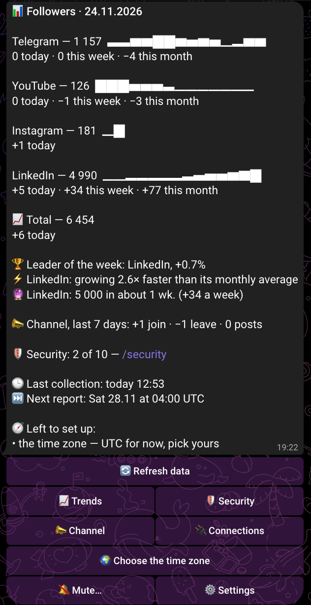
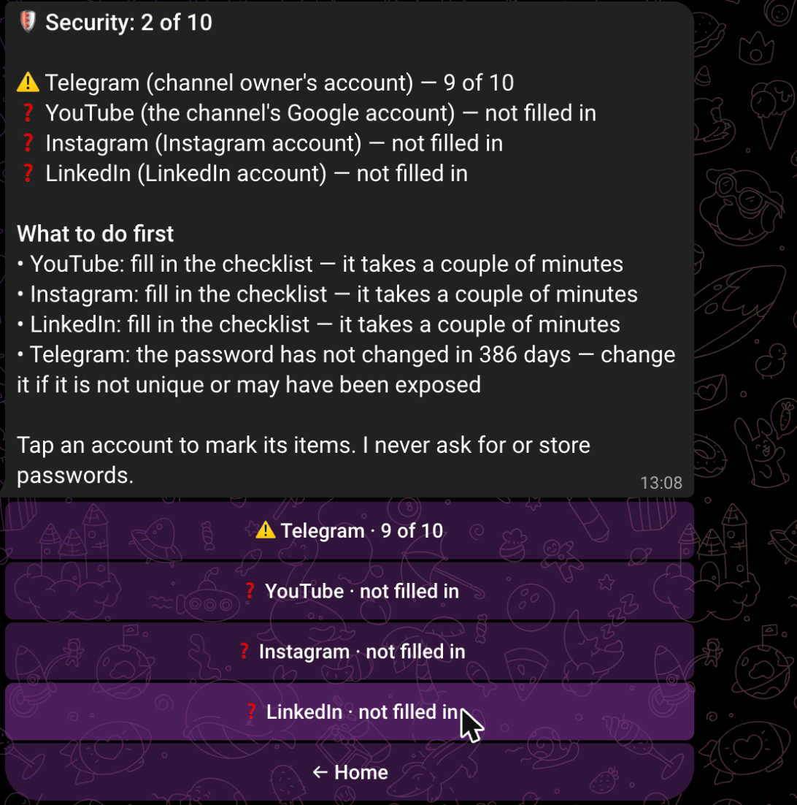
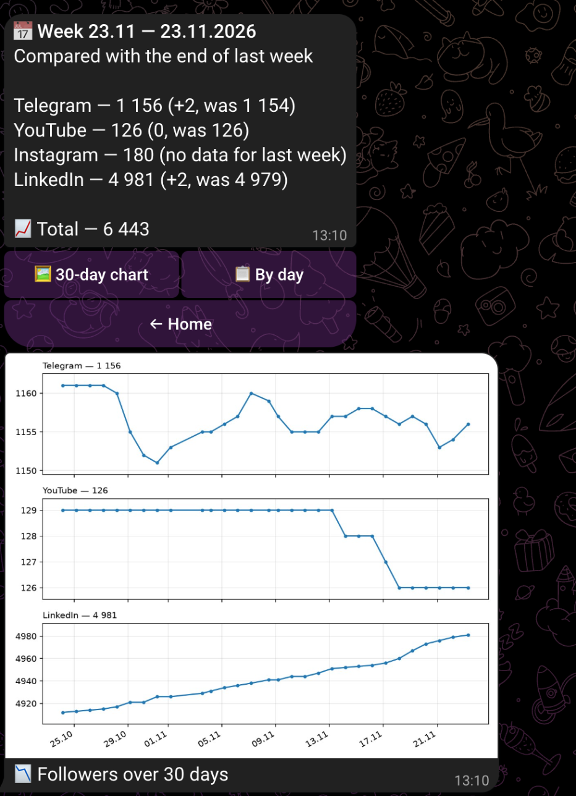

# Social Tracker Bot

> Telegram-бот на вашем сервере для ваших соцсетей: подписчики в Telegram, YouTube, Instagram и LinkedIn, жизнь канала и безопасность аккаунтов — признаки угона, письма безопасности, опасные комментарии, — а ещё недельный отчёт о том, как вас находят люди и ИИ-ассистенты. Молчит, пока всё в порядке.

🇬🇧 [In English](README.md) · [](https://railway.com/deploy/social-tracker-bot?referralCode=7hTMqE)

Это мой личный инструмент, открытый как есть: бесплатно, с открытым кодом (MIT), я пользуюсь им каждый день. Это не сервис с поддержкой — установку и подключения придётся пройти самому; для этого есть пошаговая инструкция и skill для Claude, который проведёт по шагам в браузере. Если окажется, что это нужно многим, сделаю облачную версию, где ничего не нужно ставить и настраивать.

<p align="center">
  
  
  
</p>

## Что получаете

- **Один отчёт вместо четырёх приложений.** Подписчики Telegram, YouTube, Instagram и LinkedIn за день, неделю и месяц, график за 30 дней и прогноз до круглого числа — в те дни и в тот час, что вы выберете.
- **Раннее предупреждение об угоне.** Новый админ или владелец, чужая ссылка в описании, новое название или аватарка, пропавшие видео: бот сверяет профили каждые полчаса и сразу пишет, со звуком даже ночью.
- **Письма безопасности — в Telegram.** «Новый вход», «пароль изменён», «добавлен ключ» от соцсетей, GitHub, Microsoft и Яндекса — в течение 5 минут: их пересылают в отдельный ящик, который читает бот.
- **Комментарии, за которые блокируют группу.** Наркотики, мошенничество, порно в группе обсуждения канала — карточка с кнопками «удалить» и «забанить». Сам бот ничего не удаляет и показывает, сколько стоит проверка (по вашему ключу Claude).
- **Жизнь канала.** Кто вступил и вышел и по какой ссылке, каждый пост и реакции на него.
- **Чек-лист безопасности и отчёт о репутации.** 2FA и возраст паролей по каждому аккаунту; владельцам сайтов — как часто их находят люди и ИИ-ассистенты.
- **Молчит, пока всё в порядке.** Одно сообщение, когда что-то сломалось, и одно — когда починилось; звонит только то, что нельзя отложить. Всё — кнопками; сообщение с ключом удаляется сразу.

Бот говорит по-русски или по-английски и берёт язык из вашего Telegram при первом `/start`. Все возможности, меню и команды — [docs/FEATURES.md](docs/FEATURES.md). Зачем это — [docs/WHY.md](docs/WHY.md).

## Установка

По шагам, по кликам: **[docs/SETUP.md](docs/SETUP.md)** — бот у @BotFather, кнопка Railway (одно поле, `BOT_TOKEN`), `/start`, первая сеть. На каждое подключение — своя страница в [docs/connect/](docs/connect/).

**С Claude**: skill проведёт по установке прямо в браузере — в Claude Code `/plugin install social-tracker-setup --marketplace morgunovtech/social-tracker-bot`, затем «установи Social Tracker»; для claude.ai и Cowork — zip из последнего релиза: [docs/SETUP.md](docs/SETUP.md#помощь-claude).

**Railway**: [](https://railway.com/deploy/social-tracker-bot?referralCode=7hTMqE) — в кнопке мой реферальный код Railway: Railway делится со мной частью оплаты аккаунта, созданного по ней; для вас цена та же. Без кода: <https://railway.com/deploy/social-tracker-bot>.

**Свой сервер** с Docker — одной командой: она спросит токен, запишет `.env` и `docker-compose.yml` в `~/social-tracker-bot` (другая папка — `SOCIAL_TRACKER_DIR=…`) и запустит бота; повторный запуск обновляет:

```bash
curl -fsSL https://raw.githubusercontent.com/morgunovtech/social-tracker-bot/main/scripts/install.sh | sh
```

**Или руками.** Создайте папку с двумя файлами — `.env` из одной строки `BOT_TOKEN=<токен от @BotFather>` (остальные переменные — в [`.env.example`](.env.example)) и `docker-compose.yml`:

```yaml
services:
  tracker-bot:
    image: ghcr.io/morgunovtech/social-tracker-bot:latest
    container_name: social-tracker-bot
    env_file: .env
    volumes:
      - ./data:/app/data
    restart: unless-stopped
```

Затем `docker compose up -d`. Если репозиторий склонирован, то же самое — `cp .env.example .env`, токен в `BOT_TOKEN`, `docker compose up -d`.

`docker-compose.yml` тянет образ, который публикует каждый зелёный `main` (`ghcr.io/morgunovtech/social-tracker-bot`, amd64 и arm64); чтобы запускать свои правки, замените `image:` на `build: .` и добавьте `--build`.

Логи: `docker compose logs -f`. Остановка: `docker compose down`.

## Сколько стоит

Бот бесплатный. Railway: пробные 30 дней с $5 на счёте и без карты, потом $5 в месяц на плане Hobby (нужна карта, которой можно платить за рубежом). Свой сервер — бесплатно. Проверка комментариев — около $0,01 за комментарий по вашему ключу Claude. Подробно — [docs/SETUP.md](docs/SETUP.md#сколько-стоит).

## Приватность

- Всё остаётся на вашем сервере: история, события канала, журнал безопасности — в SQLite на вашем томе. Никакой аналитики.
- Бот читает только публичные данные ваших аккаунтов, через официальные API, где они есть; пароли он не спрашивает.
- Ключи и токены, присланные в чат, сразу удаляются из него, не показываются, не пишутся в лог и не попадают в еженедельный бэкап, который бот присылает вам.
- Комментарии уходят в Claude API без имени и id автора — и только если проверка подключена.
- Что именно и куда уходит, запрос за запросом, — [полная таблица](docs/FEATURES.md#приватность). Безопасность — [SECURITY.md](SECURITY.md).

## Документы

| | |
|---|---|
| [docs/WHY.md](docs/WHY.md) | Зачем это и чего бот не делает |
| [docs/SETUP.md](docs/SETUP.md) | Установка по кликам, цены, что делать, если что-то пошло не так |
| [docs/connect/](docs/connect/) | По странице на подключение: Telegram, YouTube, Instagram, LinkedIn, сторож, письма безопасности, комментарии, репутация |
| [docs/FEATURES.md](docs/FEATURES.md) | Все возможности, меню, команды, отчёт, расписание, когда бот пишет, значки, обновления, разработка |
| [mail-worker/README.ru.md](mail-worker/README.ru.md) | Почтовый воркер на Cloudflare — путь для продвинутых |
| [SECURITY.md](SECURITY.md) · [CONTRIBUTING.md](CONTRIBUTING.md) · [CHANGELOG.md](CHANGELOG.md) | Безопасность, как помочь, что менялось (по-английски) |

## Что создаётся вне репозитория

- Telegram-бот (@BotFather) и, если нужен YouTube, API-ключ в проекте Google Cloud.
- На Railway: проект с одним сервисом, собранным из этого репозитория, и volume на `/app/data` — их создаёт шаблон (`social-tracker-bot`); чтобы убрать — удалите проект.
- Публичный пакет на GitHub, `ghcr.io/morgunovtech/social-tracker-bot` — образ, который CI публикует на каждый зелёный `main`; удаляется в Packages репозитория.
- Для Instagram: приложение Meta с вариантом Instagram API, бизнес-портфель, которому оно принадлежит, конфигурация «Facebook Login for Business» и роль Instagram Tester на вашем аккаунте. Удаление: приложение — на [developers.facebook.com](https://developers.facebook.com/apps/) (Settings → Basic → Remove app), портфель — в Meta Business Suite → Настройки компании → Информация о компании, доступ приложения — в Instagram → Настройки → Website permissions.
- Опционально: проверка на [healthchecks.io](https://healthchecks.io) или задача heartbeat в TofsDevOps (задаётся в ⏱ Сторож или `HEALTHCHECK_URL`; чтобы убрать — удалите её там) и эндпоинт вашего сайта (`SITE_INGEST_URL`).
- На GitHub, для самого этого репозитория: GitHub App SonarQube Cloud, установленный на репозиторий, и его проект на [sonarcloud.io](https://sonarcloud.io) (автоматический анализ каждого пуша и pull request, без конфигурации в репозитории) — чтобы убрать: удалите проект на sonarcloud.io и уберите репозиторий из приложения (Settings → GitHub Apps); и кнопка «Sponsor», `.github/FUNDING.yml`, ведёт на страницу владельца в GitHub Sponsors — чтобы убрать кнопку, удалите файл.
- Опционально: personal access token GitHub (`GITHUB_TOKEN`), только чтобы снять анонимный лимит запросов слежения за обновлениями; отзывается в Settings → Developer settings.
- Опционально, для писем безопасности: отдельный ящик с паролем приложения (чтобы убрать — удалите пароль в настройках аккаунта и фильтр пересылки в основном ящике) или Cloudflare Worker, KV namespace, правило Email Routing с его DNS-записями, адрес пересылки и фильтр в вашей почте — список и как всё удалить в [mail-worker/README.md](mail-worker/README.md).
- Опционально, для отчёта о репутации: проект Google Cloud с сервисным аккаунтом и его JSON-ключом, добавленным пользователем ваших ресурсов Search Console (удалить пользователя и ключ); OAuth-приложение Яндекса на oauth.yandex.ru и его токен (удалить приложение); API-токен Cloudflare с правами Zone Read и Analytics Read (удалить в My Profile → API Tokens).
- Опционально, для комментариев: API-ключ в организации Anthropic Console (присланный в чате или `ANTHROPIC_API_KEY`), оплата за каждый проверенный комментарий; чтобы убрать — отозвать ключ в Console.
- Для `scripts/clean_deleted.py`: API id и hash приложения на [my.telegram.org](https://my.telegram.org) (API development tools) и локальный файл сессии на вашем ноутбуке — `~/.social-tracker-clean-bot.session`, а с `--session user` — `~/.social-tracker-clean-user.session`, сессия вашего собственного аккаунта. Чтобы убрать: удалите файлы и завершите эту сессию в Telegram → Настройки → Устройства; приложение остаётся на my.telegram.org.

## Разработка

`ruff check .`, `pytest -q` (без сети: фейковый Telegram, локальные HTTP-серверы для каждого API), `pip-audit -r requirements.txt --strict` — как поднять venv и где что лежит: [docs/FEATURES.md](docs/FEATURES.md#разработка) и [CONTRIBUTING.md](CONTRIBUTING.md).

## Сделано с помощью

Придумал и собрал [Семён Моргунов](https://s.morgunov.tech) в паре с Claude Code.

## Лицензия

[MIT](LICENSE). Проект не связан с Telegram, YouTube, Meta или LinkedIn. Об уязвимостях — в [SECURITY.md](SECURITY.md).
